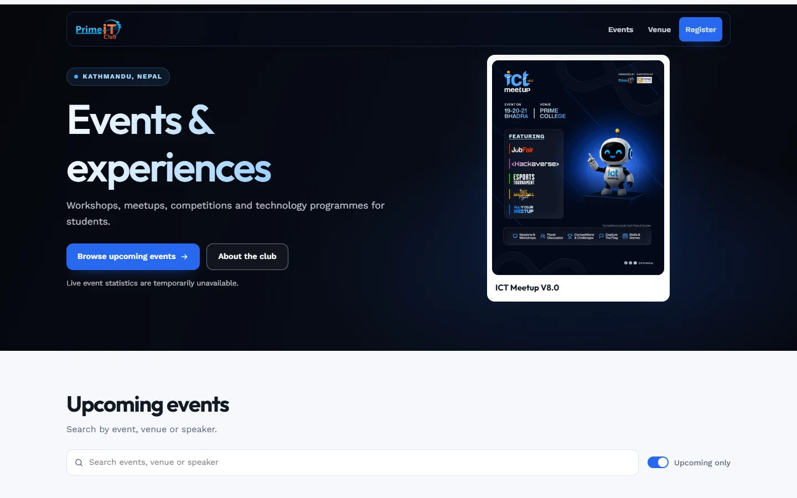

<h1>Samyog Sapkota</h1>

<strong>CSIT Student · AI & Computer Vision · Web Development</strong>

Kathmandu, Nepal · Prime College

<a href="https://samyog-sapkota.com.np">Portfolio</a> &nbsp;·&nbsp;
<a href="https://www.linkedin.com/in/samyogsapkota/">LinkedIn</a> &nbsp;·&nbsp;
<a href="mailto:samyog.sapkota1@gmail.com">Email</a>

---

## About

CSIT student building practical applications with AI, computer vision and web technologies. Public Relations Director at Prime IT Club.

## Featured projects

<table>
<tr>
<td width="50%" valign="top">

### AUVYREN · Virtual Fashion Store

3D fashion storefront with a virtual garment rail and shopping flow.

**JavaScript · Three.js · E-commerce**

<a href="https://auvyren-virtual-store-sable.vercel.app">Live demo ↗</a> · <a href="https://github.com/hola-mundo999/auvyren-virtual-store">Source ↗</a>
</td>
<td width="50%" valign="top">

### CSIT Pulse · AI Study Assistant

Study platform for TU BSc CSIT subjects, chapters and past questions, with an AI tutor.

**JavaScript · Python · AI**

<a href="https://ai-csit-study-assistant.vercel.app">Live demo ↗</a> · <a href="https://github.com/hola-mundo999/ai-csit-study-assistant">Source ↗</a>
</td>
</tr>
<tr>
<td width="50%" valign="top">

### AI Gesture Controller

Browser-based hand tracking for media and pointer control.

**JavaScript · MediaPipe · Web Audio**

<a href="https://ai-gesture-controller-murex.vercel.app">Live demo ↗</a> · <a href="https://github.com/hola-mundo999/ai-gesture-controller-">Source ↗</a>
</td>
<td width="50%" valign="top">

### Prime Event Ticket Manager

Event registration and QR check-in for Prime IT Club programmes.

**Python · FastAPI · SQLite/PostgreSQL**

<a href="https://prime-event-ticket-manager.vercel.app">Live demo ↗</a> · <a href="https://github.com/hola-mundo999/prime-event-ticket-manager">Source ↗</a>
</td>
</tr>
</table>

## Tech stack

## Contribution activity

## Other public repositories

<!-- PROJECTS:START -->
<!-- PROJECTS:END -->

Repository list refreshes automatically from my public GitHub projects.

---

<a href="https://samyog-sapkota.com.np">Portfolio</a> &nbsp;·&nbsp;
<a href="https://www.linkedin.com/in/samyogsapkota/">LinkedIn</a> &nbsp;·&nbsp;
<a href="mailto:samyog.sapkota1@gmail.com">Email</a>

