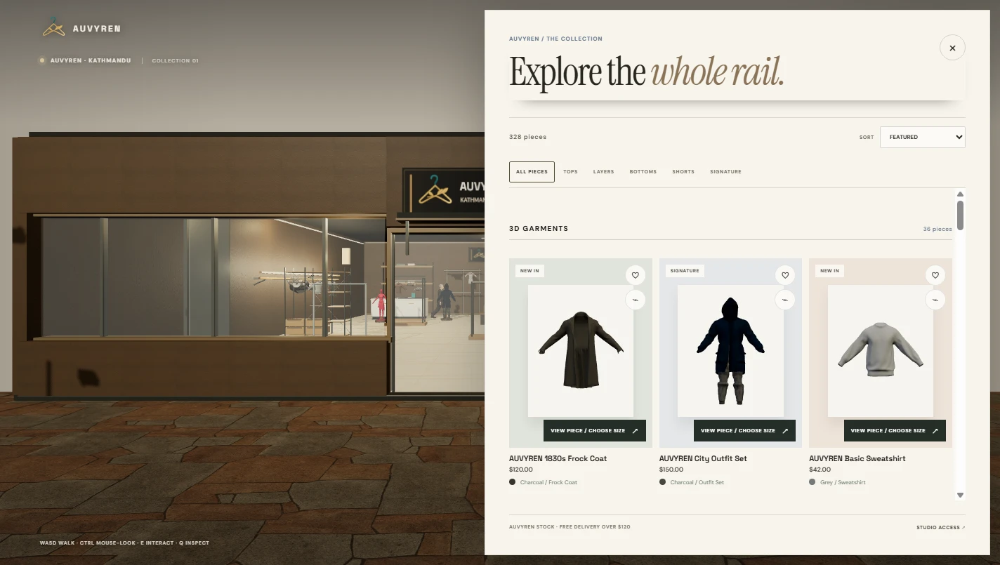
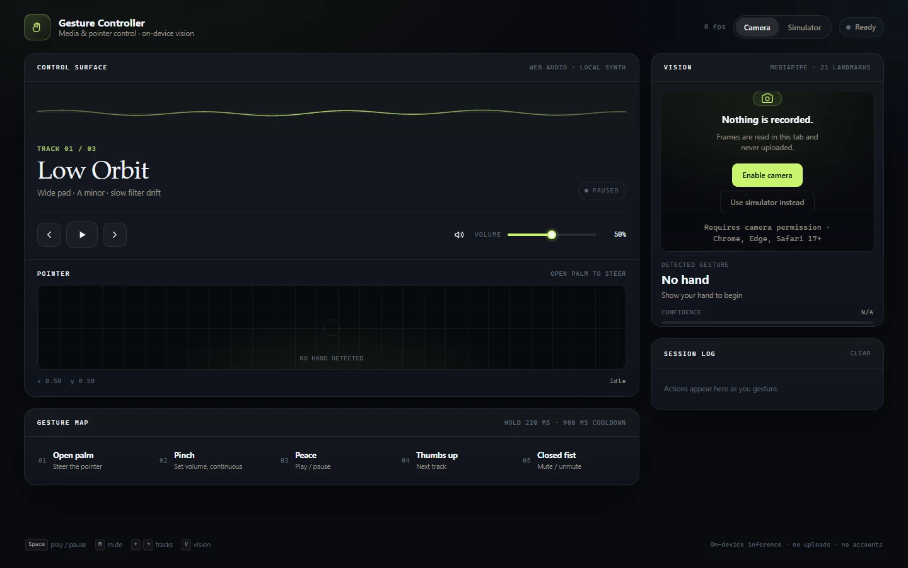
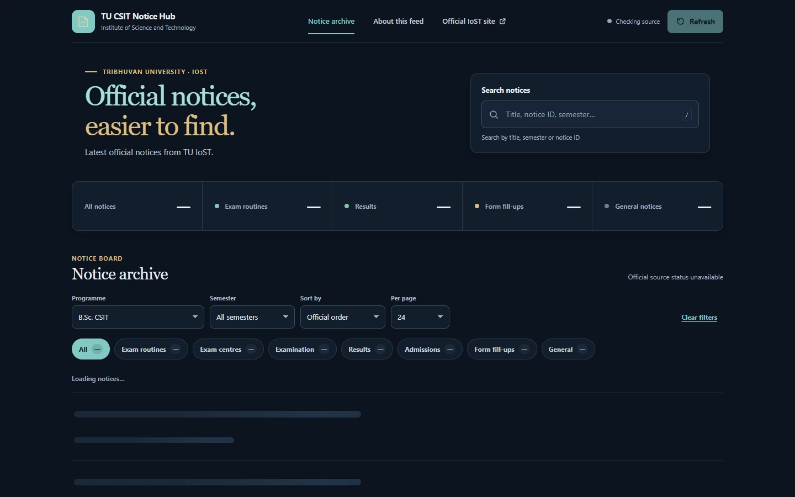

<h1>Samyog Sapkota</h1>

<strong>CSIT Student · Software Development · AI & Computer Vision</strong>

Kathmandu, Nepal · Prime College

<a href="https://samyog-sapkota.com.np">Portfolio</a> &nbsp;·&nbsp;
<a href="https://www.linkedin.com/in/samyogsapkota/">LinkedIn</a> &nbsp;·&nbsp;
<a href="mailto:samyog.sapkota1@gmail.com">Email</a>

---

Building practical applications with AI-powered web experiences.

## Selected Projects

<table>
<tr>
<td width="50%" valign="top">

### AUVYREN · Virtual Fashion Store

3D fashion storefront with a virtual garment rail and shopping flow.

**JavaScript · Three.js · E-commerce**

<a href="https://auvyren-virtual-store-sable.vercel.app">Live demo ↗</a>
</td>
<td width="50%" valign="top">

### CSIT Pulse · AI Study Assistant

Study platform for TU BSc CSIT subjects with an AI tutor.

**JavaScript · Python · AI**

<a href="https://ai-csit-study-assistant.vercel.app">Live demo ↗</a> · <a href="https://github.com/hola-mundo999/ai-csit-study-assistant">Source ↗</a>
</td>
</tr>
<tr>
<td width="50%" valign="top">

### AI Gesture Controller

Browser-based hand tracking for media and pointer control.

**JavaScript · MediaPipe · Web Audio**

<a href="https://ai-gesture-controller-murex.vercel.app">Live demo ↗</a> · <a href="https://github.com/hola-mundo999/ai-gesture-controller-">Source ↗</a>
</td>
<td width="50%" valign="top">

### Prime Event Ticket Manager

Event registration and QR check-in for club programmes.

**Python · FastAPI · SQLite/PostgreSQL**

<a href="https://prime-event-ticket-manager.vercel.app">Live demo ↗</a> · <a href="https://github.com/hola-mundo999/prime-event-ticket-manager">Source ↗</a>
</td>
</tr>
<tr>
<td colspan="2" width="100%" valign="top">

### TU CSIT Notice Hub

Tracks official IOST notices, routines and results for TU CSIT students.

**Python · FastAPI**

<a href="https://tu-csit-notice-hub.vercel.app">Live demo ↗</a> · <a href="https://github.com/hola-mundo999/tu-csit-notice-hub">Source ↗</a>
</td>
</tr>
</table>

## Tech Stack

**Languages**: Python · JavaScript · CSS

**Frameworks**: React · FastAPI · Three.js

**AI/ML**: OpenCV · MediaPipe

**Infrastructure**: PostgreSQL · Supabase · GitHub Pages

## GitHub Activity

## Other Public Repositories

<!-- PROJECTS:START -->
<table>
<thead><tr><th>Project</th><th>About</th><th>Language</th><th>Demo</th></tr></thead>
<tbody>
<tr><td><a href="https://github.com/hola-mundo999/country-info-app"><strong>Country Explorer</strong></a></td><td>Explore country profiles, geographic data and key facts.</td><td>CSS</td><td><a href="https://country-info-explorer-phi.vercel.app">Live ↗</a></td></tr>
<tr><td><a href="https://github.com/hola-mundo999/github-user-finder"><strong>GitHub Finder</strong></a></td><td>Search GitHub users and explore their public profiles.</td><td>CSS</td><td><a href="https://github-user-finder-jade-alpha.vercel.app">Live ↗</a></td></tr>
<tr><td><a href="https://github.com/hola-mundo999/note-app"><strong>NoteNest</strong></a></td><td>A minimalist Markdown notebook for notes and study.</td><td>JavaScript</td><td><a href="https://note-app-nu-two.vercel.app">Live ↗</a></td></tr>
<tr><td><a href="https://github.com/hola-mundo999/password-generator"><strong>PassForge</strong></a></td><td>Generate secure passwords with a cryptographic strength meter.</td><td>JavaScript</td><td><a href="https://password-generator-delta-liard.vercel.app">Live ↗</a></td></tr>
<tr><td><a href="https://github.com/hola-mundo999/random-color-palette"><strong>Paletto</strong></a></td><td>Generate harmonious colour palettes with contrast checks.</td><td>CSS</td><td><a href="https://random-color-palette-snowy.vercel.app">Live ↗</a></td></tr>
<tr><td><a href="https://github.com/hola-mundo999/tu-csit-notice-hub"><strong>TU CSIT Notice Hub</strong></a></td><td>Tracks official IOST notices, routines and results for TU CSIT students.</td><td>Python</td><td><a href="https://tu-csit-notice-hub.vercel.app">Live ↗</a></td></tr>
<tr><td><a href="https://github.com/hola-mundo999/result-card-generator"><strong>Result Announced</strong></a></td><td>Generate printable TU examination result cards.</td><td>CSS</td><td><a href="https://result-card-generator-red.vercel.app">Live ↗</a></td></tr>
</tbody>
</table>
<!-- PROJECTS:END -->

Repository list refreshes automatically from my public GitHub projects.

---

<a href="https://samyog-sapkota.com.np">Portfolio</a> &nbsp;·&nbsp;
<a href="https://www.linkedin.com/in/samyogsapkota/">LinkedIn</a> &nbsp;·&nbsp;
<a href="mailto:samyog.sapkota1@gmail.com">Email</a>

