


 

  <b>Software Developer</b> &nbsp;·&nbsp;
  <b>Applied AI &amp; Computer Vision</b> &nbsp;·&nbsp;
  <b>BSc CSIT @ Prime College</b>

  
  
  
  

### 👨‍💻 About Me

- 🎓 **Academic**: Pursuing **B.Sc. CSIT** (Computer Science and Information Technology) at **Prime College**, Tribhuvan University (*Class of '27*).
- 🚀 **Leadership**: **PR Advisor** at **Prime IT Club**, advising on tech events, student outreach, workshops, and hackathons.
- 💡 **Interests**: Applied Artificial Intelligence, Large Language Models (LLM integrations), Computer Vision, Python backends, and full-stack web applications.
- 🛠️ **Current Focus**: Engineering student-centric academic tools, AI assistants, and automated systems for university students.

### 🛰️ Live Deployments

Production builds, newest first. Every card opens the deployed site — the source repos can stay private, the work doesn't.

<!-- LIVE-DEPLOYMENTS:START -->

<table>
  <tr>
    <td align="center" width="50%">
      <a href="https://auvyren-virtual-store-sable.vercel.app"></a>
    </td>
    <td align="center" width="50%">
      <a href="https://samyog-sapkota.com.np"></a>
    </td>
  </tr>
  <tr>
    <td align="center" width="50%">
      <a href="https://note-app-nu-two.vercel.app"></a>
    </td>
    <td align="center" width="50%">
      <a href="https://github-user-finder-jade-alpha.vercel.app"></a>
    </td>
  </tr>
  <tr>
    <td align="center" width="50%">
      <a href="https://result-card-generator-red.vercel.app"></a>
    </td>
    <td align="center" width="50%">
      <a href="https://random-color-palette-snowy.vercel.app"></a>
    </td>
  </tr>
  <tr>
    <td align="center" width="50%">
      <a href="https://password-generator-delta-liard.vercel.app"></a>
    </td>
    <td align="center" width="50%">
      <a href="https://country-info-explorer-phi.vercel.app"></a>
    </td>
  </tr>
</table>

<code>8 live builds</code> · every card opens the deployed site · auto-synced from Vercel

<!-- LIVE-DEPLOYMENTS:END -->

### 🚀 Featured Projects

<table>
  <thead>
    <tr>
      <th width="30%">Project</th>
      <th width="50%">Description</th>
      <th width="20%">Tech Stack</th>
    </tr>
  </thead>
  <tbody>
    <tr>
      <td>
        <b><a href="https://github.com/hola-mundo999/ai-csit-study-assistant">⚡ TU CSIT Pulse</a></b> 
        
      </td>
      <td>Smart Academic Learning Platform &amp; Multi-Model AI Tutor (Groq, Gemini, ChatGPT) for TU BSc CSIT students with verified semester notes and solved past board exams.</td>
      <td><code>Python</code> <code>Streamlit</code> <code>Groq</code> <code>Gemini</code></td>
    </tr>
    <tr>
      <td>
        <b><a href="https://github.com/hola-mundo999/ai-gesture-controller-">🖐️ AI Gesture Controller</a></b> 
        
      </td>
      <td>Real-time Computer Vision desktop interface using hand landmark tracking for touchless slide navigation and media control.</td>
      <td><code>Python</code> <code>OpenCV</code> <code>MediaPipe</code></td>
    </tr>
    <tr>
      <td>
        <b><a href="https://github.com/hola-mundo999/prime-event-ticket-manager">🎟️ Prime Event Ticket Manager</a></b> 
        
      </td>
      <td>Cryptographic QR registration and verification system engineered for Prime IT Club hackathons, workshops, and campus events.</td>
      <td><code>Python</code> <code>FastAPI</code> <code>QR Code</code></td>
    </tr>
    <tr>
      <td>
        <b><a href="https://github.com/hola-mundo999/tu-csit-notice-hub">📢 TU CSIT Notice Hub</a></b> 
        
      </td>
      <td>Automated web scraping and alert pipeline monitoring official Tribhuvan University (IOST) notices, exam routines, and results.</td>
      <td><code>Python</code> <code>BeautifulSoup</code> <code>Automation</code></td>
    </tr>
    <tr>
      <td>
        <b>🌐 3D Developer Portfolio</b> 
        
      </td>
      <td>High-performance personal portfolio featuring 3D graphics, fluid animations, and project showcase.</td>
      <td><code>React 19</code> <code>Three.js</code> <code>Tailwind v4</code></td>
    </tr>
  </tbody>
</table>

### 🛠️ Tech Stack &amp; Tooling

| Domain | Technologies &amp; Tools |
| :--- | :--- |
| **Languages** |       |
| **AI &amp; Vision** |      |
| **Web &amp; Backend** |      |
| **DevOps &amp; Tools** |      |

### 💻 Terminal Activity &amp; Stats

<h3><code>samyog@github ~ $ whoami</code></h3>

<table>
<tr>
<td valign="top"></td>
<td valign="top"></td>
</tr>
</table>

 

<h3><code>samyog@github ~ $ ./contributions.sh</code></h3>


 
 

