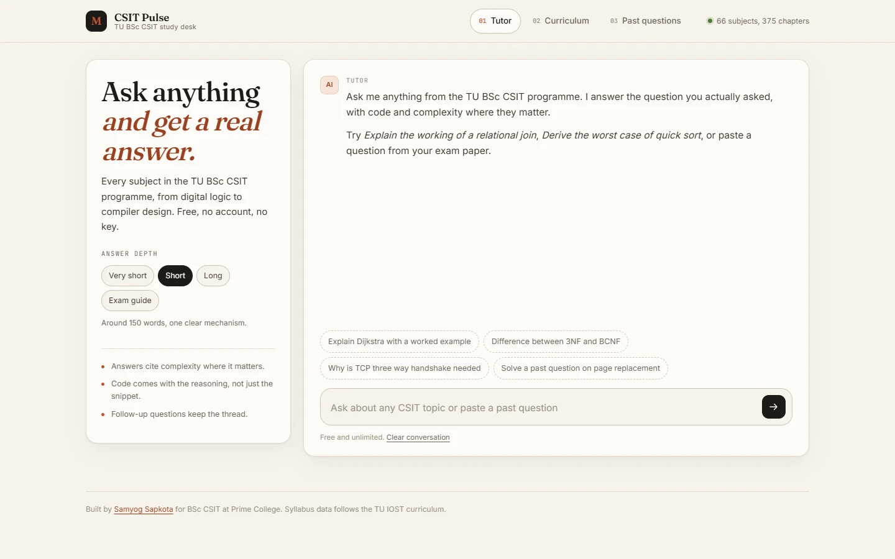
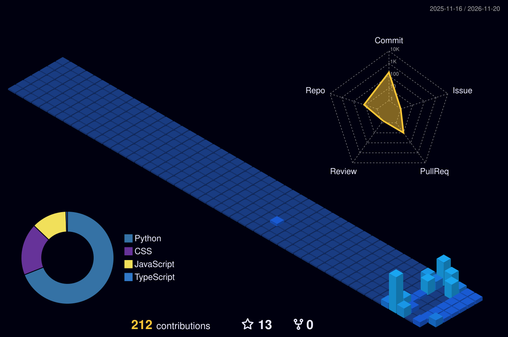
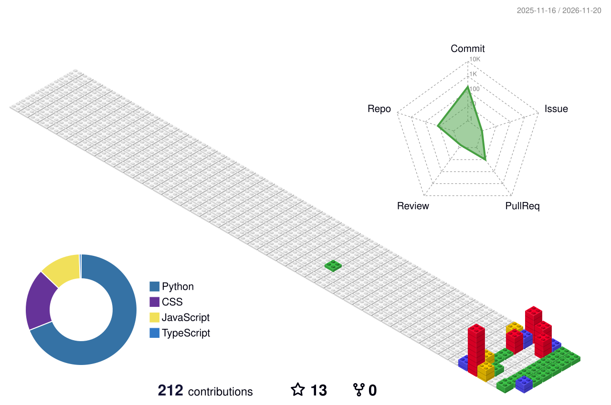
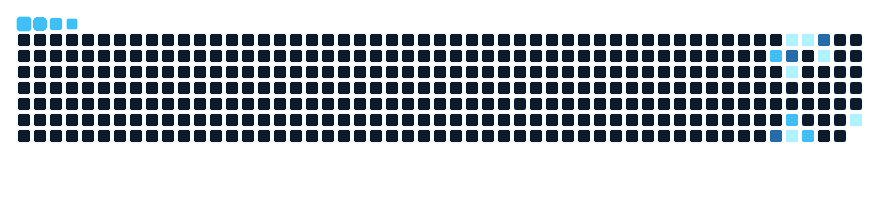

<h1>Samyog Sapkota</h1>

**Software Developer · Applied AI · Computer Vision · 3D Web**

Kathmandu, Nepal · BSc CSIT, Prime College

<a href="https://samyog-sapkota.com.np">Portfolio</a> &nbsp;·&nbsp;
<a href="https://www.linkedin.com/in/samyogsapkota/">LinkedIn</a> &nbsp;·&nbsp;
<a href="mailto:samyog.sapkota1@gmail.com">Email</a>

---

## About

I’m a BSc CSIT student at Prime College who learns by building real software. I work across browser-based computer vision, AI-assisted learning tools, automation, backend systems and interactive web experiences.

I care about more than getting a demo to work: I like understanding the problem, shaping a clear interface, testing edge cases and making the result useful.

- **Building with:** Python, JavaScript, React, FastAPI and browser technologies.
- **Exploring:** applied AI, computer vision, Three.js and practical full-stack systems.
- **Community:** Public Relations Director at Prime IT Club, connecting students, clubs and industry.

## Selected work

These are screenshots of the real applications, not decorative mockups.

<table>
<tr>
<td width="50%" valign="top">

### AUVYREN · 3D Virtual Store

A virtual fashion storefront with a 3D garment rail, product discovery and a shopping flow.

**JavaScript · 3D assets · E-commerce**

<a href="https://auvyren-virtual-store-sable.vercel.app">Live demo ↗</a> · <a href="https://github.com/hola-mundo999/auvyren-virtual-store">Source ↗</a>
</td>
<td width="50%" valign="top">

### CSIT Pulse · AI Study Assistant

A TU BSc CSIT study desk with eight semesters, 66 subjects, 375 chapters, past questions and an AI tutor.

**JavaScript · Python · AI integration**

<a href="https://ai-csit-study-assistant.vercel.app">Live demo ↗</a> · <a href="https://github.com/hola-mundo999/ai-csit-study-assistant">Source ↗</a>
</td>
</tr>
<tr>
<td width="50%" valign="top">

### AI Gesture Controller

A browser-based hand-tracking controller for media and pointer actions. Landmark inference runs in the browser.

**JavaScript · MediaPipe · Web Audio**

<a href="https://ai-gesture-controller-murex.vercel.app">Live demo ↗</a> · <a href="https://github.com/hola-mundo999/ai-gesture-controller-">Source ↗</a>
</td>
<td width="50%" valign="top">

### Prime Event Ticket Manager

Event registration and QR check-in built for Prime IT Club programmes, backed by a FastAPI service and event-management tools.

**Python · FastAPI · SQLite/PostgreSQL · QR**

<a href="https://prime-event-ticket-manager.vercel.app">Live demo ↗</a> · <a href="https://github.com/hola-mundo999/prime-event-ticket-manager">Source ↗</a>
</td>
</tr>
<tr>
<td width="50%" valign="top">

### TU CSIT Notice Hub

Monitors official IOST notices, identifies routines and results, and organises updates for CSIT students.

**Python · BeautifulSoup · SQLite · Streamlit**

<a href="https://github.com/hola-mundo999/tu-csit-notice-hub">Source ↗</a>
</td>
<td width="50%" valign="top">

### More projects

- [3D Developer Portfolio](https://samyog-sapkota.com.np) — interactive portfolio and experiments.
- [NoteNest](https://note-app-nu-two.vercel.app) — local-first Markdown notebook.
- [GitHub Finder](https://github-user-finder-jade-alpha.vercel.app) — GitHub profile lookup.
- [Result Announced](https://result-card-generator-red.vercel.app) — printable TU result cards.
- [Paletto](https://random-color-palette-snowy.vercel.app) — colour palette generator.
- [PassForge](https://password-generator-delta-liard.vercel.app) — Web Crypto password generator.
- [Country Explorer](https://country-info-explorer-phi.vercel.app) — country information explorer.
</td>
</tr>
</table>

## Tools I use

## GitHub in 3D

The following is generated from my actual GitHub contribution history. It is an isometric 3D contribution calendar, not a manually drawn banner.

## Contribution activity

---

**Interested in building useful things with good people.**

<a href="https://samyog-sapkota.com.np">Portfolio</a> &nbsp;·&nbsp;
<a href="https://www.linkedin.com/in/samyogsapkota/">LinkedIn</a> &nbsp;·&nbsp;
<a href="mailto:samyog.sapkota1@gmail.com">Email</a>

