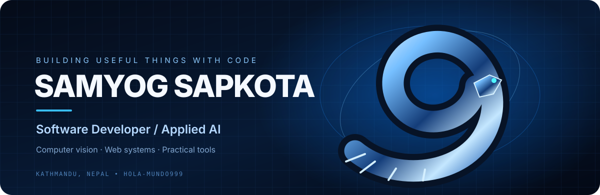

 

  Software Developer · Applied AI & Computer Vision · BSc CSIT @ Prime College, Kathmandu

  <a href="https://samyog-sapkota.com.np">Portfolio</a> ·
  <a href="https://www.linkedin.com/in/samyogsapkota/">LinkedIn</a> ·
  <a href="mailto:samyog.sapkota1@gmail.com">Email</a> ·
  <a href="https://github.com/hola-mundo999">GitHub</a>

---

### About

I'm a BSc CSIT student at Prime College and Public Relations Director at Prime IT Club. I build academic tools, web applications, and computer vision projects. My current focus is applied AI, Python backends, and interactive systems.

---

### Technologies I Build With

---

### Featured Projects

**AI Study Assistant** — Semester notes and verified board exam solutions for TU BSc CSIT. Choose answers from Groq, Gemini, or ChatGPT.  
`Python, FastAPI, LLM, Streamlit`

 

**AI Gesture Controller** — Browser-based hand tracking for media playback, volume, mute, track selection, and pointer controls. Camera frames stay in the browser.  
`Python, MediaPipe, OpenCV, WebRTC`

 

**Prime Event Ticket Manager** — QR registration and ticket checks for Prime IT Club events.  
`React, Node.js, MongoDB, QR Code`

 

**TU CSIT Notice Hub** — Checks official IOST notices, exam routines, and results automatically.  
`Python, BeautifulSoup, Vercel`

---

<!-- LIVE-DEPLOYMENTS:START -->

<table>
  <tr>
    <td align="center" width="50%">
      
    </td>
    <td align="center" width="50%">
      
    </td>
  </tr>
  <tr>
    <td align="center" width="50%">
      
    </td>
    <td align="center" width="50%">
      
    </td>
  </tr>
  <tr>
    <td align="center" width="50%">
      
    </td>
    <td align="center" width="50%">
      
    </td>
  </tr>
  <tr>
    <td align="center" width="50%">
      
    </td>
    <td align="center" width="50%">
      
    </td>
  </tr>
</table>

<code>8 live builds</code> · every card opens the deployed site · auto-synced from Vercel

<!-- LIVE-DEPLOYMENTS:END -->

---

### Contributions Dashboard

  
  

---

### Contribution Heatmap

  

---

### Contribution Snake

  

  The green snake traces my contribution graph, updated automatically every 6 hours.

---

### Footer

  

