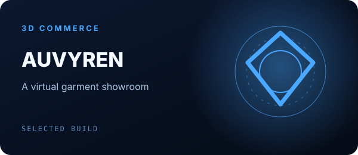
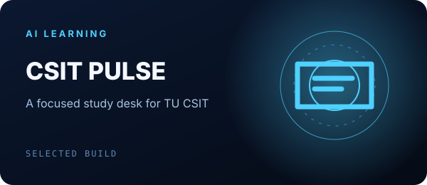
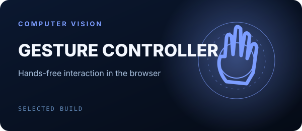

 

**I build practical software at the intersection of web development, automation and applied AI.**

---

## 01 / About

I'm a BSc CSIT student at **Prime College, Kathmandu**, interested in turning ideas into useful, working products. My work ranges from browser-based computer vision and AI-assisted study tools to full-stack applications, automation and interactive 3D experiences.

I learn by building: understanding a problem, shipping a working version, testing the details and improving it.

- **Currently exploring:** applied AI, computer vision, full-stack engineering and 3D web experiences.
- **Approach:** practical problem-solving, clear interfaces and systems that do what they promise.
- **Beyond code:** Public Relations Director at Prime IT Club, connecting students, clubs and industry.

## 02 / Selected work

<table>
<tr>
<td width="50%" valign="top">

**[AUVYREN — 3D Virtual Store](https://auvyren-virtual-store-sable.vercel.app)**

A virtual storefront with a 3D garment rail, product discovery and shopping flow.

JavaScript · 3D assets · E-commerce UI
</td>
<td width="50%" valign="top">

**[CSIT Pulse — AI Study Assistant](https://github.com/hola-mundo999/ai-csit-study-assistant)**

A TU BSc CSIT study desk covering eight semesters, 66 subjects, 375 chapters, past questions and an AI tutor.

JavaScript · Python · AI integration
</td>
</tr>
<tr>
<td width="50%" valign="top">

**[AI Gesture Controller](https://github.com/hola-mundo999/ai-gesture-controller-)**

Browser-based hand tracking that maps five gestures to media and pointer controls, with on-device inference.

JavaScript · MediaPipe · Web Audio
</td>
<td width="50%" valign="top">

**[Prime Event Ticket Manager](https://github.com/hola-mundo999/prime-event-ticket-manager)**

Event registration and QR check-in system built for Prime IT Club programmes, with a FastAPI backend and admin console.

Python · FastAPI · SQLite/PostgreSQL
</td>
</tr>
</table>

<strong>More experiments & small builds</strong>

- [3D Developer Portfolio](https://samyog-sapkota.com.np) — interactive personal portfolio.
- [TU CSIT Notice Hub](https://github.com/hola-mundo999/tu-csit-notice-hub) — academic notice scraping, categorisation and alerts.
- [NoteNest](https://note-app-nu-two.vercel.app) — local-first Markdown notebook.
- [GitHub Finder](https://github-user-finder-jade-alpha.vercel.app) — GitHub profile lookup.
- [Result Announced](https://result-card-generator-red.vercel.app) — printable TU result cards.
- [Paletto](https://random-color-palette-snowy.vercel.app) — colour palette generator.
- [PassForge](https://password-generator-delta-liard.vercel.app) — Web Crypto password generator.
- [Country Explorer](https://country-info-explorer-phi.vercel.app) — country information explorer.

## 03 / Tools I work with

Tools used across my projects; this is not a claim of equal proficiency in every technology.

## 04 / GitHub activity

Activity artwork refreshes automatically. GitHub's native contribution calendar remains the source of truth.

## 05 / Connect

I'm open to collaborating on practical software, AI-powered tools and interesting web projects.

<a href="https://samyog-sapkota.com.np"><strong>Portfolio</strong></a> ·
<a href="https://www.linkedin.com/in/samyogsapkota"><strong>LinkedIn</strong></a> ·
<a href="mailto:samyog.sapkota1@gmail.com"><strong>Email</strong></a>

Built with curiosity · Kathmandu, Nepal

